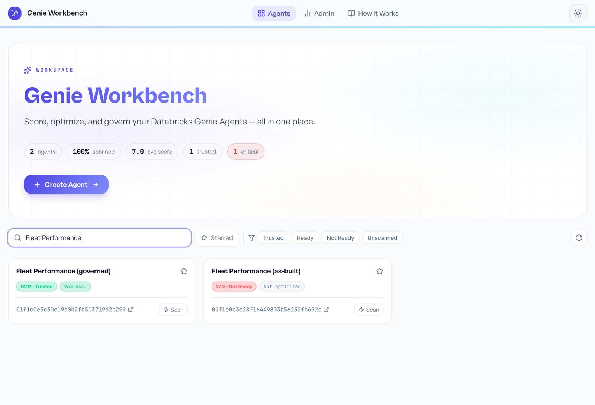
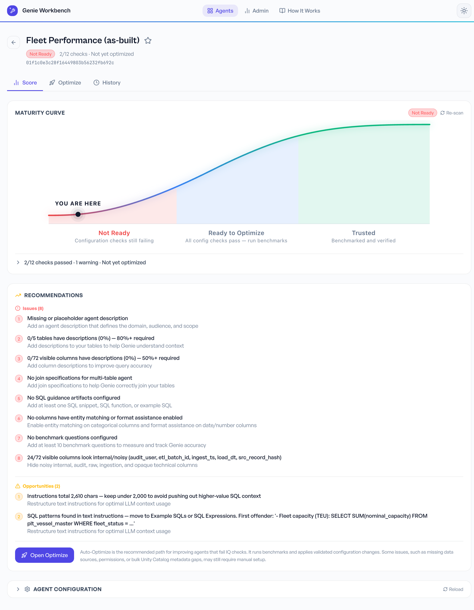
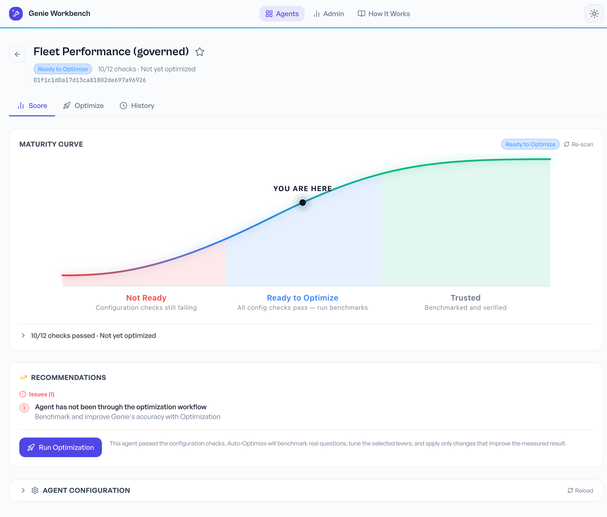
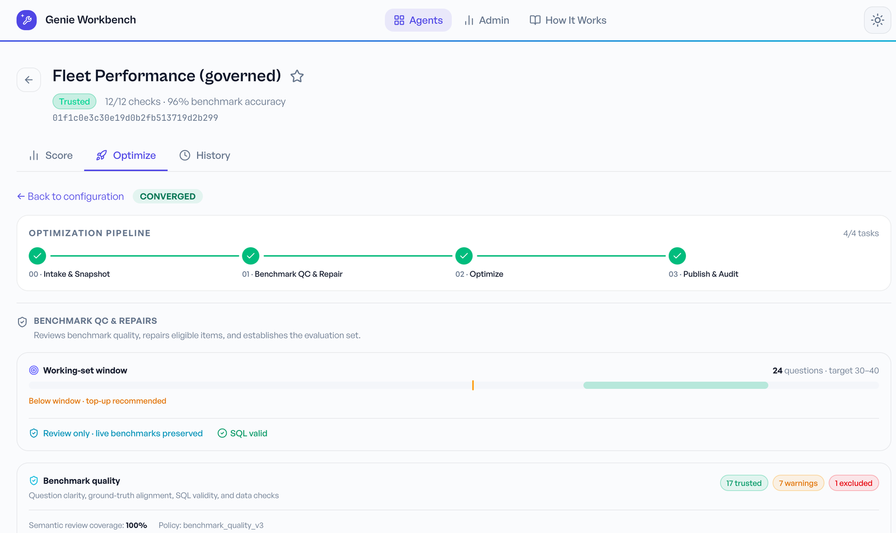
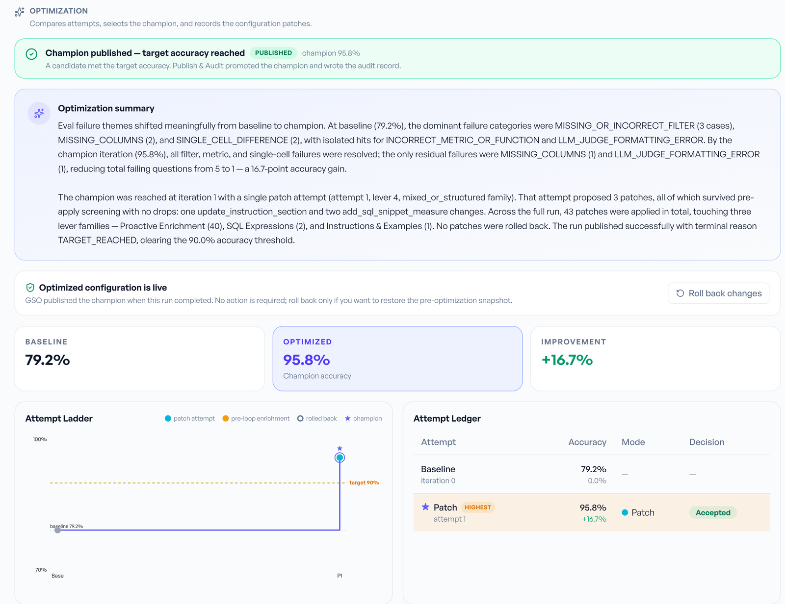
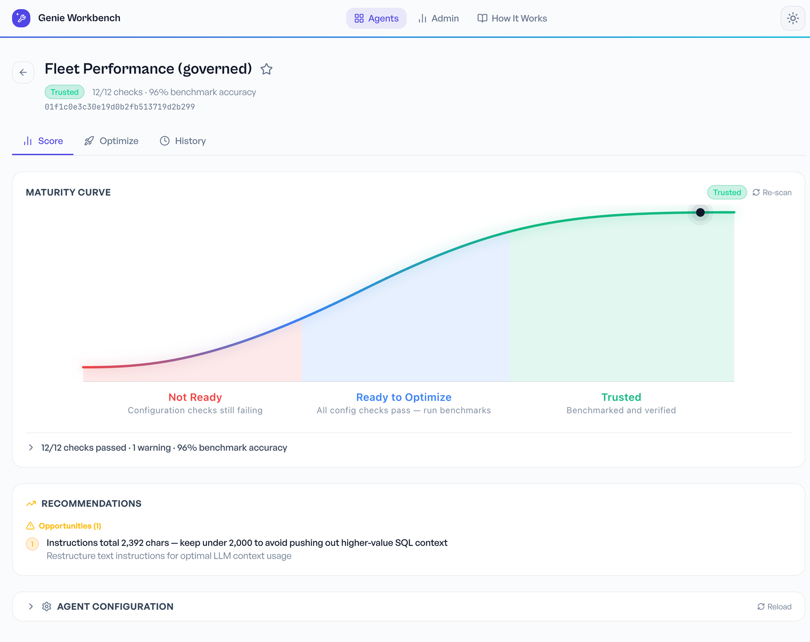

# Genie Workbench Demo: Fleet Performance Agents

A worked example of [Genie Workbench](https://github.com/databricks-solutions/databricks-genie-workbench), the open-source Databricks Solutions app for scoring, testing and optimizing Genie Agents (formerly Genie spaces). It builds the same Fleet Performance agent two ways, once quickly on raw tables and once on a governed view layer, and walks through how Genie Workbench diagnoses the first, scores both, and uses benchmark questions to raise accuracy automatically.

The example centres on a problem that is common in mixed fleets. Containerships measure capacity in TEU and car carriers (PCTCs) measure it in CEU, and an agent built without that context will happily add the two together or report car-carrier capacity in TEU. All data in this repository is synthetic: the vessels, charterers, rates and events are fictional.

You can use the repository in two ways. Section 2 is a complete walkthrough with screenshots from a real run, so you can follow the story without setting anything up. Section 3 explains how to rebuild the example in your own Databricks workspace with the included notebooks and try every step yourself.

## 1. What is in this repository

| Path | Purpose |
|---|---|
| `README.md` | This walkthrough and setup guide. |
| `walkthrough.pdf` | The same guide as a PDF, for offline reading. |
| `notebooks/01_fleet_demo_setup.py` | Databricks notebook that generates the synthetic data, creates the tables and views, creates both Genie Agents, and grants Genie Workbench access to them. |
| `notebooks/02_fleet_demo_cleanup.py` | Databricks notebook that removes the demo agents and the demo schema. |
| `screenshots/` | Full-size screenshots used in Section 2. |

## 2. The walkthrough

The example uses five tables of synthetic fleet data: a vessel register of 245 vessels (225 containerships and 20 PCTCs), a charter book, 151,000 daily noon reports, off-hire events and IMO CII ratings. Two Genie Agents answer questions over that data.

- **Fleet Performance (as-built)** points directly at the raw "platinum" tables. The vessel register stores capacity in a single `nominal_capacity` column with a one-letter unit code, and ETL audit columns are visible. Its instructions were assembled by copying notes from other agents, including a line, written before any PCTCs joined the fleet, that says capacity is measured in TEU.
- **Fleet Performance (governed)** points at five governed views with Unity Catalog descriptions. Capacity is split into `capacity_teu` and `capacity_ceu` with an explicit `capacity_unit` column. The agent has short disambiguation instructions, join definitions, governed measures and filters, example SQL, and 25 benchmark questions that define what a correct answer is.

### Step 1: Reproduce the problem in Genie

Ask both agents **"What is our total fleet capacity?"** The as-built agent answers 2,662,500 TEU, because it adds 140,000 CEU of car-carrier capacity into a TEU total. The governed agent answers 2,522,500 TEU across 225 containerships and 140,000 CEU across 20 PCTCs, reporting each unit separately.

Then ask **"What is the total capacity of our PCTC fleet?"** The as-built agent answers 140,000 TEU and the governed agent answers 140,000 CEU. In testing, the as-built agent reported the wrong unit on every attempt. The language model is not at fault. It was given an ambiguous column and an outdated instruction, and nothing in the build process checked either one.

### Step 2: Diagnose the as-built agent with the IQ scan

Open the as-built agent in Genie Workbench and choose **Run IQ Scan**. The scan is rule-based, makes no language-model calls and completes in about a second. The as-built agent scores **2 of 12, Not Ready**. The findings explain why it answered incorrectly: none of its 5 tables or 72 columns has a description, 24 of the 72 visible columns are ETL noise such as `etl_batch_id` and `audit_user`, and it has no join definitions, SQL guidance, entity matching or benchmark questions. The scan also reports that the instructions run to over 2,000 characters and contain pasted SQL. The first SQL line it flags is the "Fleet capacity (TEU)" note that caused the wrong answer in Step 1.

### Step 3: Compare the governed agent

Scan the governed agent. Before optimization it scores **10 of 12, Ready to Optimize**: every configuration check passes, and the two remaining checks are passed only by completing an optimization run. The governed design follows a pattern that scales across domains. Genie reads a stable layer of described views rather than physical tables, so a change to a platinum column does not break the agent. Business rules such as the TEU and CEU distinction live in the data and in one short instruction, rather than being copied between agents.

A second useful question for both agents is **"Which CS-10000 vessels are burning more fuel than their sister ships?"** The synthetic data contains four hull-fouled CS-10000 vessels. The governed agent returns exactly those four, because it compares sea days only within the design class. The as-built agent returns all 14 vessels in its result, because it averages in days spent in port.

### Step 4: Run Auto-Optimize

On the governed agent, open the **Optimize** tab and choose **Start Optimization**. Auto-Optimize runs a four-step job.

1. **Intake and Snapshot** records the agent's configuration so that any change can be rolled back.
2. **Benchmark QC and Repair** reviews the benchmark questions before using them. In our run it accepted 24 of the 25 questions and excluded one whose correct answer could be ambiguous if two charterers ever tied. On an earlier run it had flagged three ranking questions that lacked a tie-breaker. Auto-Optimize requires at least 15 valid benchmarks and will not run with fewer.
3. **Optimize** measures baseline accuracy against the benchmarks, then proposes, tests and keeps only the configuration changes that improve the measured result.
4. **Publish and Audit** promotes the best configuration and writes an audit record.

In our run, accuracy rose from **79.2% to 95.8%** on the first patch attempt, against a target of 90%. The run applied 43 changes: 40 low-risk metadata enrichments, 2 new SQL measures and 1 revision to the disambiguation instructions. None were rolled back, and **Roll back changes** restores the original configuration at any time. The run took about 25 minutes.

After the run, the governed agent scores **12 of 12, Trusted, at 96% benchmark accuracy**, and the History tab records the progression from the first scan.

The practical value is the evaluation gate. When a platinum table changes, the team reruns the benchmarks and Auto-Optimize instead of repeating a full round of business user acceptance testing, and the run history serves as the audit trail.

## 3. Running the example in your workspace

### 3.1 Prerequisites

- A Databricks workspace with Unity Catalog, Databricks Apps and serverless compute.
- A catalog in which you can create a schema, and a SQL warehouse you can use (serverless recommended).
- Permission to create Genie Agents.
- For Auto-Optimize, access to an Agent Bricks Foundation Model API endpoint. Genie Workbench defaults to Claude Sonnet 4.6 and lists the models available in your workspace.

The notebooks use only standard Unity Catalog SQL and the Databricks SDK. They have been tested end to end on serverless compute, including a rerun and the cleanup notebook.

### 3.2 Install Genie Workbench

Follow the [Deployment Guide](https://databricks-solutions.github.io/databricks-genie-workbench/) in the Genie Workbench repository. The recommended method is to clone that repository into a Databricks Git folder and run `notebooks/install.py` on serverless compute. Note the following before you install:

- The installer creates a Databricks App, a Unity Catalog schema for optimization results, an optional Lakebase database for scan history, and a job for Auto-Optimize. It usually needs workspace-admin-level permissions.
- If it is not already enabled, a workspace admin must turn on **Databricks Apps On-Behalf-Of User Authorization** on the Previews page, so that the app can act as the signed-in user.

### 3.3 Create the demo data and agents

1. Import both notebooks from the `notebooks/` folder into your workspace (**Workspace**, then **Import**, then upload each `.py` file), or clone this repository into a Databricks Git folder.
2. Open `01_fleet_demo_setup`, attach serverless compute, and set the widgets:
    - **catalog**: a catalog where you can create a schema (required).
    - **schema**: defaults to `fleet_genie_demo`.
    - **warehouse_id**: the SQL warehouse the agents should use. If left blank, the notebook picks one.
    - **agents_folder**: where to create the agents. If left blank, a `fleet-genie-demo` folder in your home folder is used.
    - **workbench_app_name**: the name you gave Genie Workbench at install, `genie-workbench` by default. Leave it blank to skip the grants.
3. Choose **Run all**. The notebook takes about two minutes and ends with links to both agents in Genie and in Genie Workbench.

The data generator is seeded, so your data and answers should match the numbers in Section 2. The notebook also validates all 25 benchmark answers before creating the agents. Rerunning it rebuilds the data and updates the same two agents in place.

**Grants.** Genie Workbench scans agents as the signed-in user, but Auto-Optimize runs as the app's service principal. When you supply the app name, the notebook grants that service principal `USE CATALOG` on the catalog; `USE SCHEMA`, `SELECT` and `MODIFY` on the demo schema only; and `CAN_MANAGE` on the two demo agents. It adds these grants without replacing anyone else's access. If you prefer to grant access manually, leave the app name blank.

### 3.4 Follow the walkthrough

Open Genie Workbench, search for **Fleet Performance**, and repeat Steps 1 to 4 from Section 2. Start Auto-Optimize with the default settings and allow about 25 minutes for it to finish. Genie and the optimizer both use language models, so individual answers and the final accuracy may differ slightly from the run shown here.

### 3.5 Clean up

Run `02_fleet_demo_cleanup` with the same catalog and schema, and set **confirm** to `yes`. It moves both demo agents to the trash and drops the demo schema. The optimization history that Genie Workbench stores in its own schema remains until you remove it.

## 4. Applying the pattern to your own agents

1. **Scan every agent.** The IQ scan is read-only and instant, so it is a quick way to see where each agent stands and which gaps matter most.
2. **Point agents at a governed layer.** Use described views or metric views between the platinum tables and Genie, so that backend changes are absorbed in one place.
3. **Put meaning in the data.** Units, definitions and synonyms belong in Unity Catalog descriptions and explicit columns. Copying them into every agent's instructions creates long, inconsistent text that is hard to keep current.
4. **Keep instructions short.** Move SQL into example SQL and SQL expressions, and keep text instructions under about 2,000 characters.
5. **Write benchmarks early.** Give each agent at least 15 benchmark questions, with 30 to 40 recommended. Make each answer deterministic, for example by adding a tie-breaker to every ranking query.
6. **Use Auto-Optimize as a regression gate.** Rerun it after a schema change or a new release, and treat the accuracy result as the acceptance test.

## 5. Notes

- **Data.** All data in this repository is synthetic and was generated for this example. It does not describe any real company's fleet, contracts or performance.
- **Cost.** IQ scans make no language-model calls. An Auto-Optimize run uses a serverless job, SQL warehouse queries and Foundation Model API calls.
- **Status.** This is an independent example project, provided as-is. It is not an official Databricks product, and neither it nor Genie Workbench is covered by Databricks Support. Genie Agents themselves are a supported Databricks product. Questions about Genie Workbench belong in its GitHub repository.
